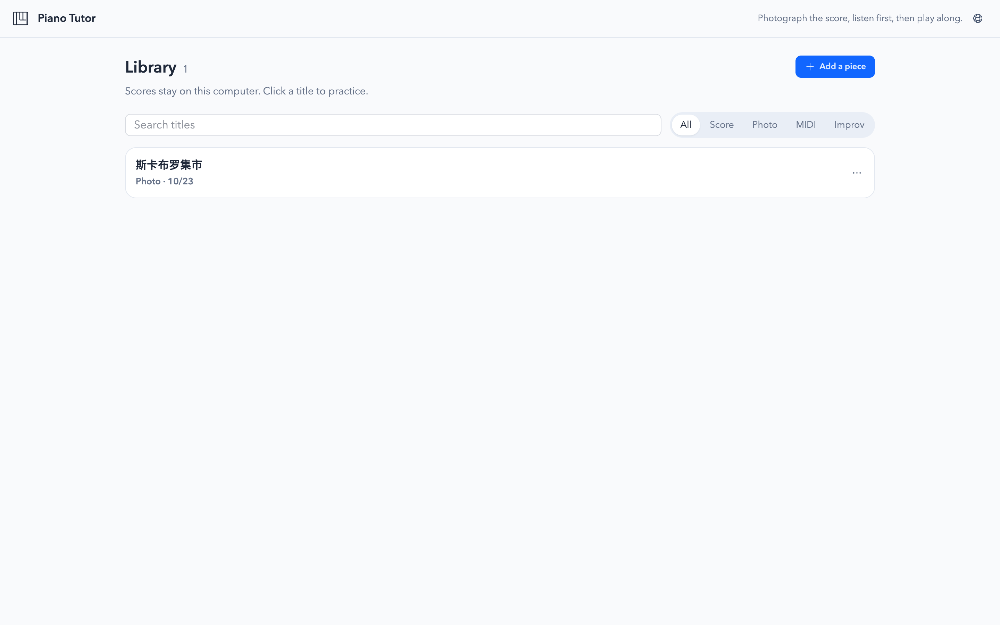
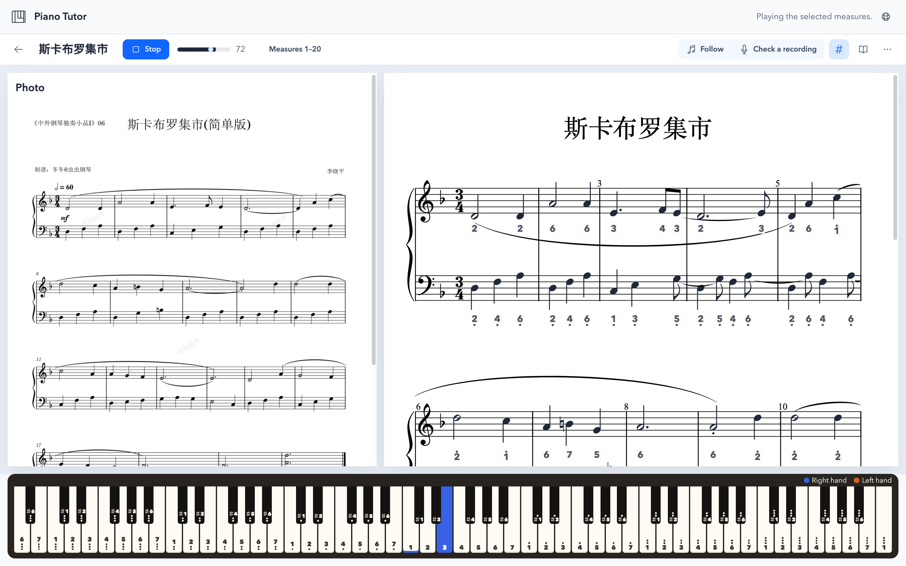
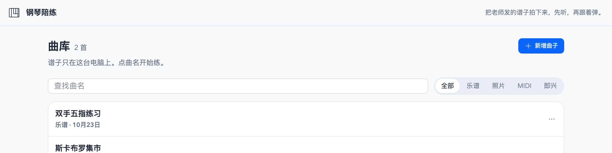
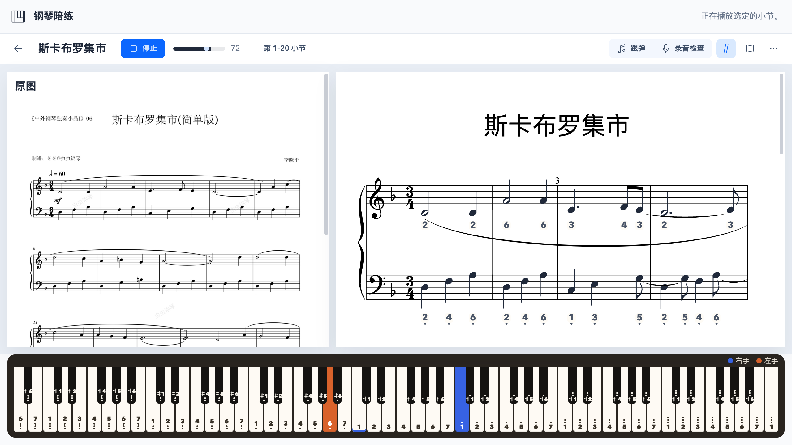

# Piano Tutor · 钢琴陪练

**English** | [中文](#zh)

<a id="en"></a>

## English

A piano practice helper that runs entirely on your own computer: import the sheet music your teacher sent, listen to it first, play along, then let it point out the wrong notes.





**In short:** it runs completely locally, so your pieces and recordings never leave your computer; it can turn a photo of sheet music into a playable score; and the interface is available in English and Chinese.

### Features

**Library**

- Search titles and filter by source (All / Score / Photo / MIDI / Improv).
- Add, rename, delete, export as MusicXML, and open a piece's folder in Finder.

**Import**

- MusicXML (`.musicxml` / `.xml`).
- MIDI (`.mid`), automatically converted to staff notation.
- Photo recognition (OMR): up to 12 pages at once. Reorder them by dragging or with Move up / Move down, and they are joined into one piece with continuous measure numbers. If one page comes out wrong, you can redo just that page or replace its photo. Recognition uses [homr](https://github.com/liebharc/homr), run through `uvx` in its own environment.
- **Improvise**: play anything at the piano (up to 3 minutes); when you stop, it is written out as a score.

**Practice**

- Scores are rendered with OpenSheetMusicDisplay and played back with a built-in piano sound. You can change the tempo, choose a range of measures, and zoom.
- Numbered notation (Jianpu) toggle: the numbers are shown under each line of the staff.
- An 88-key keyboard lights up the keys being played: blue for the right hand, orange for the left.
- **Follow** (play-along): listens through the microphone one note at a time and only moves on when you play the right note. You can also tap the on-screen keys or use your computer keyboard.
- **Check a recording**: record a whole passage of the selected measures; it is transcribed in the background, and wrong notes, missed notes, and unsteady rhythm are marked on the score.
- **How to read this**: explains the clefs, key signature, time signature, tempo, note values, and common markings of the piece in plain language.
- **Circle a marking**: draw a box on the score to learn what the markings inside mean and how to play them. Clicking a note that has a marking explains it too. Every explanation is kept under "Markings you asked about".
- **Show the photo**: for pieces imported from photos, view the original image side by side with the score.
- Simple editing: click a note to **Raise a semitone** or **Lower a semitone**, change its duration (Whole, Half, Quarter, Eighth), or **Remove** it. Click the title on the score to rename the piece.

### Requirements

- macOS ("Open folder" uses the macOS `open` command)
- Python 3.12
- Node.js (to build the frontend; `tests/follow.test.ts` needs a Node version that runs `.ts` files directly, 22.18 or later)
- [uv](https://docs.astral.sh/uv/) (provides `uvx`, needed for photo recognition)

### Install and run

```bash
cd piano-tutor

# 1. Python environment
python3.12 -m venv .venv
.venv/bin/pip install -r requirements.txt
# Check a recording and Improvise need the piano transcription package (includes torch, fairly large)
.venv/bin/pip install -r requirements-ml.txt

# 2. Frontend
cd frontend
npm install
npm run build
cd ..

# 3. Start
MPLCONFIGDIR=.mpl .venv/bin/python -m backend
```

Then open <http://127.0.0.1:8765/> in your browser.

Without `requirements-ml.txt` you can still import, view, and play back scores; only Check a recording and Improvise are unavailable.

### Usage

**Language**

Click the globe icon on the right of the top bar and choose **中文** or **English**. Until you choose, the app follows your browser: Chinese if the browser language is Chinese, English otherwise. Your choice is remembered in this browser. AI answers follow the interface language too.

**Import a piece**

1. In the library, click **Add a piece** in the top right.
2. Pick a method:
   - **MusicXML / MIDI**: choose a file and you can start practicing right away.
   - **Photo or score image**: you can choose several pages at once; put them in order (drag, or **Move up** / **Move down**), then click **Start reading**. Progress is shown in the library. For best results, take photos flat and evenly lit, with the staves filling the frame.
   - **Improvise**: put the computer near the piano, play, then click **Stop and write the score**.

**Practice**

- Click a title to open the practice page. Click **Play** to listen; drag the **Tempo** slider to slow down; click **Measures x–y** to practice only certain measures.
- In the top right, `#` toggles numbered notation (Jianpu), the book icon opens **How to read this**, and the **More** menu (**⋯**) has **Circle a marking**, **Show the photo**, **Clear marks**, **Manage pages**, **Export**, **Open folder**, and **Delete**.

**Follow (play-along)**

- Choose the measures, click **Follow**, and play one note at a time at the piano. A banner tells you which note to play, and the note is also highlighted on the score and the keyboard. It moves on only when it hears the right note; if you play a wrong one, it tells you which note it heard. Notes of a chord are checked one at a time.
- You can play along without a real piano or a microphone: tap the on-screen keys, or use your computer keyboard. The layout starts at middle C by default:

  | Computer key | A | W | S | E | D | F | T | G | Y | H | U | J | K |
  | --- | --- | --- | --- | --- | --- | --- | --- | --- | --- | --- | --- | --- | --- |
  | Note | C | C♯ | D | D♯ | E | F | F♯ | G | G♯ | A | A♯ | B | C (octave up) |

  `Z` / `X` shift down / up an octave. These keys and the on-screen keys also make sound when Follow is off.
- The microphone can stay on at the same time: after you tap or press a key, the microphone is ignored for a moment so the speaker's sound isn't mistaken for your playing. Without microphone permission, Follow still works.

**Check a recording**

- Choose the measures, click **Check a recording**, play those measures all the way through, then click stop.
- After a short wait, wrong notes, missed notes, and unsteady rhythm are marked on the score, following the legend. Use **More → Clear marks** to remove them.

**Simple edits**

- Click a note to **Raise a semitone** / **Lower a semitone**, change its duration, or **Remove** it. Changes are saved straight to the piece's `score.musicxml`.

**Detailed editing with MuseScore**

This app only handles the simple edits above. For detailed editing, such as adding or removing measures, changing key or time signatures, fixing slurs, ties, and expression markings, correcting large recognition errors, or rearranging voices, we recommend the free [MuseScore](https://musescore.org):

1. Click **Export** from the **⋯** next to a title in the library, or from the **More** menu on the practice page. You get a `.musicxml` file (uncompressed MusicXML). Alternatively, click **Open folder** and use the `score.musicxml` inside.
2. Open the file in MuseScore and edit it.
3. In MuseScore, choose **File → Export**, pick MusicXML, and select uncompressed `.musicxml`. This app only imports `.musicxml` and `.xml`; compressed `.mxl` is not supported.
4. Back in the library, import it with **Add a piece → MusicXML**.

Notes:

- There is no "replace score" feature, so re-importing creates a new piece. The original photos (Show the photo), the markings you asked about, and recording-check history do not carry over.
- Once you're happy with the new piece, you can delete the old one.

**Microphone permission**

Browsers only allow microphone access on secure addresses. Open the app at `http://127.0.0.1:8765/`. If you open it via a LAN IP (for example `http://192.168.x.x:8765/`), Check a recording, Improvise, and listening during Follow won't work; Follow will only accept on-screen keys or the computer keyboard.

### Configuration

The language model is only used for **Circle a marking** and for explaining markings when you click a note (**Explain with AI**). Settings go in a `.env` file in the project root, which is not committed to git.

```bash
cp .env.example .env
```

Then edit `.env`:

| Variable | Description |
| --- | --- |
| `PIANO_AI_API_KEY` | API key for the language model. If empty, only the explanations the app reads from the score are shown and nothing goes online. |
| `PIANO_AI_BASE_URL` | Base URL of an OpenAI-compatible `/chat/completions` API. |
| `PIANO_AI_MODEL` | Model name. |

For example, with DeepSeek:

```bash
PIANO_AI_API_KEY=<your API key>
PIANO_AI_BASE_URL=https://api.deepseek.com/v1
PIANO_AI_MODEL=deepseek-chat
```

Variables with the same names already exported in your environment take precedence over `.env`. Settings from older versions in `data/config.json` are still read; if the same setting has a value in `.env`, `.env` wins.

Note: the markings are identified by the app from the score itself. Only a text description of those marks is sent to the model, never images, so an ordinary chat model is enough. Don't commit `.env`.

### Data storage

All data stays on this computer in the `data/` directory (set the `PIANO_DATA` environment variable to use another location):

```text
data/
├── models/                  # Piano transcription model weights, downloaded automatically if missing (about 170 MB)
└── pieces/
    └── <piece id>/
        ├── meta.json        # Title, source, status, per-page recognition progress
        ├── score.musicxml   # The current score (overwritten when edited)
        ├── pages/           # Photo imports: 001.png, 001.musicxml, … one set per page
        ├── improv.wav       # Original improv recording
        ├── takes/           # Recording checks: each take's .wav and analysis .json
        └── asks.json        # Markings you asked about (up to 40)
```

Deleting a piece removes its whole `<piece id>/` directory.

### FAQ

**What if recognition gets a lot wrong?**

For a few mistakes, click the notes on the practice page and fix them there. For many mistakes, export the score, fix it in MuseScore, and import it again; see "Detailed editing with MuseScore" above.

**Why is the first photo recognition so slow?**

On the first run, `uvx` has to set up a Python 3.12 environment for homr, and homr downloads its recognition models from GitHub (about 180 MB). The models are stored inside the homr package in the uv cache (`$(uv cache dir)/archive-v0/<hash>/lib/python3.12/site-packages/homr/`) and are not downloaded again.

Later recognitions still take a while: each page starts a new homr process, which loads the models into memory again before recognizing. It is not downloading them again. Multiple pages are recognized one after another; a single page is abandoned after 20 minutes.

The models are downloaded once more after you clear the uv cache (`uv cache clean`) or after homr is upgraded.

**Why does the first recording check take so long?**

The first time, the piano transcription model is downloaded from Zenodo into `data/models/`. If the download fails you'll see a message; just record again.

**I changed the frontend code but the page didn't change?**

The backend serves `frontend/dist/` directly, so rebuild after frontend changes:

```bash
cd frontend && npm run build
```

Then refresh the browser.

**The page only says the interface hasn't been built?**

Same as above: run `npm install` and `npm run build` in the `frontend` directory.

### Development

**Tests**

```bash
.venv/bin/python -m pytest
node tests/follow.test.ts
```

**Frontend development**

```bash
cd frontend
npm run dev      # http://127.0.0.1:5173/, proxies /api to 127.0.0.1:8765; start the backend first
npm run build    # Type-checks and builds into frontend/dist/
```

Frontend: Vite + TypeScript, OpenSheetMusicDisplay (score rendering), soundfont-player (piano sound; samples in `frontend/public/soundfonts/`), pitchy (pitch detection for play-along), Tailwind CSS 4 + daisyUI.

Backend: FastAPI + music21, homr for recognition, piano-transcription-inference for transcription.

**Project layout**

```text
piano-tutor/
├── backend/
│   ├── __main__.py      # Entry point: python -m backend, listens on 127.0.0.1:8765
│   ├── main.py          # HTTP API; also serves the frontend/dist pages
│   ├── store.py         # Library: import, recognition jobs, editing, recording checks
│   ├── omr.py           # Runs homr for photo recognition
│   ├── pages.py         # Joins multi-page recognition results into one piece
│   ├── midi_score.py    # MIDI to score
│   ├── transcribe.py    # Piano recording transcription; downloads the model automatically
│   ├── notate.py        # Writes transcribed notes as a score (Improvise)
│   ├── align.py         # Check a recording: compares the score with the performance
│   ├── score_ops.py     # MusicXML read/write, note IDs, editing
│   ├── explain.py       # "How to read this" and marking explanations
│   ├── vision.py        # Reads settings and calls the language model to explain markings
│   └── paths.py         # Paths such as data/
├── frontend/
│   ├── index.html
│   ├── src/             # main.ts, score.ts, keyboard.ts, audio.ts, pitch.ts, follow.ts, …
│   └── public/soundfonts/
├── tests/               # pytest tests and follow.test.ts
├── .env.example         # Language model settings template (copy to .env and fill in; don't commit .env)
├── data/                # Local data (see above)
├── requirements.txt
└── requirements-ml.txt
```

---

<a id="zh"></a>

## 中文

[English](#en) | **中文**

一个只跑在自己电脑上的钢琴练琴助手：把老师发的谱子导进来，先听，再跟着弹，弹完让它帮忙找错音。





### 功能

**曲库**

- 按曲名搜索，按来源筛选（乐谱 / 照片 / MIDI / 即兴）。
- 新增、改名、删除、导出 MusicXML、在 Finder 里打开曲子所在目录。

**导入**

- MusicXML（`.musicxml` / `.xml`）。
- MIDI（`.mid`），自动写成五线谱。
- 拍照识谱：一次最多 12 页，可以拖动或用上移、下移调整顺序，按顺序拼成一首，小节号连续。某一页没认好，可以只重做这一页，或换一张照片。识谱用 [homr](https://github.com/liebharc/homr)，通过 `uvx` 在独立环境里运行。
- 即兴录音：对着钢琴随便弹（最长 3 分钟），停下后自动写成谱。

**练琴**

- 用 OpenSheetMusicDisplay 画谱，内置钢琴音源播放；可以调速度、选小节范围、缩放。
- 简谱开关：简谱数字写在每行五线谱下面。
- 88 键键盘，播放时按下的键会亮，右手蓝色、左手橙色。
- 跟弹：用麦克风一个音一个音地听，弹对了才往下走；也可以点屏幕琴键或用电脑键盘弹。
- 录音检查：选好小节后整段录音，后台转写后在谱上标出错音、漏音和节奏不稳的地方。
- 「这首怎么读」：用界面语言讲解这首的谱号、调号、拍号、速度、音符时值和常见记号。
- 「圈记号」：在谱上框出一块，说明里面的记号是什么、怎么弹。点一下带记号的音符也会说明。问过的记号会保存在「问过的记号」里。
- 对照原图：照片导入的曲子可以把原图和谱并排看。
- 简单编辑：点一个音符，可以升 / 降半音、改时值（全音符、二分、四分、八分）或去掉这个音；点谱上的标题可以改曲名。

### 环境要求

- macOS（「打开目录」用的是 macOS 的 `open` 命令）
- Python 3.12
- Node.js（用来构建前端；`tests/follow.test.ts` 需要能直接跑 `.ts` 的 Node，22.18 及以上）
- [uv](https://docs.astral.sh/uv/)（提供 `uvx`，拍照识谱要用）

### 安装和启动

```bash
cd piano-tutor

# 1. Python 环境
python3.12 -m venv .venv
.venv/bin/pip install -r requirements.txt
# 录音检查和即兴录音需要钢琴转写组件（包含 torch，比较大）
.venv/bin/pip install -r requirements-ml.txt

# 2. 前端
cd frontend
npm install
npm run build
cd ..

# 3. 启动
MPLCONFIGDIR=.mpl .venv/bin/python -m backend
```

然后在浏览器打开 <http://127.0.0.1:8765/>。

不装 `requirements-ml.txt` 也能导入、看谱和播放，只是录音检查和即兴录音用不了。

### 使用说明

**界面语言**

点顶部导航条右侧的地球图标，选「中文」或「English」。没选过时跟随浏览器语言：浏览器是中文就显示中文，否则显示英文；选过之后这个浏览器会记住。AI 的回答也会跟随界面语言。

**导入一首曲子**

1. 曲库右上角点「新增曲子」。
2. 选一种方式：
   - **MusicXML / MIDI**：选文件，马上就能练。
   - **拍照 / 选谱子图片**：可以一次选多页，排好顺序后点「开始识别」。曲库里会显示识别进度。照片尽量拍平、光线均匀，让五线谱占满画面。
   - **即兴录音**：把电脑靠近钢琴，弹完点「停止并写成谱」。

**练习**

- 点曲名进入练琴页。点「播放」听一遍；拖动速度条可以放慢；点「第 x–y 小节」选只练哪几小节。
- 右上角的 `#` 是简谱开关，书本图标是「这首怎么读」，「⋯」里有圈记号、对照原图、管理页面、导出、删除等。

**跟弹**

- 选好小节，点「跟弹」，对着钢琴一个音一个音地弹。上方会提示「请弹某个音」，谱上和键盘也会标出这个音；听到弹对了才往下走，弹错时会说听到的是哪个音。写在一起的和弦会拆开一个个对。
- 没有真钢琴、没有麦克风也能跟弹：点屏幕上的琴键，或用电脑键盘弹。键位如下，默认从中央 C 开始：

  | 电脑键 | A | W | S | E | D | F | T | G | Y | H | U | J | K |
  | --- | --- | --- | --- | --- | --- | --- | --- | --- | --- | --- | --- | --- | --- |
  | 音 | C | C♯ | D | D♯ | E | F | F♯ | G | G♯ | A | A♯ | B | 高八度 C |

  `Z` / `X` 降 / 升一个八度。没开跟弹时，这些键和屏幕琴键也能直接发声。
- 麦克风可以同时开着：点键或按键后，会有一小段时间不听麦克风，免得把喇叭里的声音当成弹的音。没有麦克风权限时，跟弹照常可用。

**录音检查**

- 选好小节，点「录音检查」，把这几小节完整弹一遍再点停止。
- 稍等片刻，谱上会按图例标出弹错的音、漏弹的音和节奏不稳的地方。点「⋯ → 清除标记」可以去掉。

**简单改谱**

- 点一个音符，可以升 / 降半音、改时值，或去掉这个音。改动直接保存到这首曲子的 `score.musicxml`。

**细致改谱：配合 MuseScore**

本软件只能做上面这些简单修改。想细致改谱，比如加减小节、改调号拍号、改连线和表情记号、修正识谱的大面积错误、调整声部，推荐配合免费的 [MuseScore](https://musescore.org)：

1. 在曲库里曲名右边的「⋯」或练琴页的「⋯」里点「导出」，得到一个 `.musicxml` 文件（未压缩的 MusicXML）。也可以点「打开目录」，直接用里面的 `score.musicxml`。
2. 用 MuseScore 打开这个文件并修改。
3. 在 MuseScore 里选「文件 → 导出」，格式选 MusicXML，并选未压缩的 `.musicxml`。本软件导入只接受 `.musicxml` 和 `.xml`，不支持压缩的 `.mxl`。
4. 回到曲库，用「新增曲子 → MusicXML」导入。

注意：

- 本软件没有「替换乐谱」功能，重新导入会变成一首新曲子。原来的照片（对照原图）、问过的记号和录音检查记录都不会带过去。
- 新的这首确认没问题后，可以把旧的那一首删掉。

**麦克风权限**

浏览器只允许在安全的地址上用麦克风。请用 `http://127.0.0.1:8765/` 打开；用局域网 IP（例如 `http://192.168.x.x:8765/`）打开时，录音检查、即兴录音和跟弹时的听音都用不了，跟弹只能用屏幕琴键或电脑键盘。

### 配置

大模型只用于「圈记号」和点记号时的说明（「让 AI 说明」）。配置放在项目根目录的 `.env`，这个文件不会被 git 提交。

```bash
cp .env.example .env
```

然后编辑 `.env`：

| 变量 | 说明 |
| --- | --- |
| `PIANO_AI_API_KEY` | 大模型 API key。留空时只显示程序自己认出的记号说明，不联网。 |
| `PIANO_AI_BASE_URL` | 兼容 OpenAI `/chat/completions` 接口的地址。 |
| `PIANO_AI_MODEL` | 模型名。 |

例如用 DeepSeek：

```bash
PIANO_AI_API_KEY=<你的 API key>
PIANO_AI_BASE_URL=https://api.deepseek.com/v1
PIANO_AI_MODEL=deepseek-chat
```

已经导出到环境里的同名变量优先于 `.env`。更早版本写在 `data/config.json` 里的配置仍能读到；同一项在 `.env` 里有值时，以 `.env` 为准。

说明：记号是程序从谱里认出来的，发给模型的只有这些记号的文字描述，不发图片，所以普通的对话模型就够用。不要把 `.env` 提交上去。

### 数据存放

所有数据都只在本机的 `data/` 目录里（可以用环境变量 `PIANO_DATA` 换到别的目录）：

```text
data/
├── models/                  # 钢琴转写模型权重，缺少时自动下载（约 170 MB）
└── pieces/
    └── <曲子 id>/
        ├── meta.json        # 曲名、来源、状态、每页识别进度
        ├── score.musicxml   # 当前的谱（编辑后会覆盖）
        ├── pages/           # 照片导入：001.png、001.musicxml……每页一份
        ├── improv.wav       # 即兴录音的原始录音
        ├── takes/           # 录音检查：每次的 .wav 和分析结果 .json
        └── asks.json        # 问过的记号（最多 40 条）
```

删除曲子会把整个 `<曲子 id>/` 目录删掉。

### 常见问题

**识谱错得多怎么办？**

错得少，就在练琴页直接点音符修改；错得多，导出后用 MuseScore 修改再导入，见上文「细致改谱：配合 MuseScore」。

**第一次拍照识谱特别慢？**

第一次运行时，`uvx` 要为 homr 准备一个 Python 3.12 环境，homr 还要从 GitHub 下载识谱模型（约 180 MB）。模型放在 uv 缓存里 homr 包自己的目录下（`$(uv cache dir)/archive-v0/<hash>/lib/python3.12/site-packages/homr/`），之后不会再下载。

之后每次识谱仍然要等一会儿：每一页都会启动一个新的 homr 进程，把模型重新加载进内存再识别，这不是在重复下载。多页时按顺序一页一页识别；单页超过 20 分钟会自动放弃。

清理 uv 缓存（`uv cache clean`）或 homr 升级后，会重新下载一次。

**录音检查第一次很久？**

第一次用时会从 Zenodo 下载钢琴转写模型到 `data/models/`。下载失败会提示，重新录一次即可。

**改了前端代码，页面没变化？**

后端直接读 `frontend/dist/`，前端改动后要重新构建：

```bash
cd frontend && npm run build
```

然后刷新浏览器。

**打开页面只看到「界面还没有构建」？**

同上，在 `frontend` 目录运行 `npm install` 和 `npm run build`。

### 开发

**测试**

```bash
.venv/bin/python -m pytest
node tests/follow.test.ts
```

**前端开发**

```bash
cd frontend
npm run dev      # http://127.0.0.1:5173/，/api 会代理到 127.0.0.1:8765，后端要先启动
npm run build    # 类型检查并构建到 frontend/dist/
```

前端：Vite + TypeScript、OpenSheetMusicDisplay（画谱）、soundfont-player（钢琴音源，音色文件在 `frontend/public/soundfonts/`）、pitchy（跟弹听音）、Tailwind CSS 4 + daisyUI。

后端：FastAPI + music21，识谱用 homr，转写用 piano-transcription-inference。

**目录结构**

```text
piano-tutor/
├── backend/
│   ├── __main__.py      # 入口：python -m backend，监听 127.0.0.1:8765
│   ├── main.py          # HTTP 接口，并提供 frontend/dist 页面
│   ├── store.py         # 曲库：导入、识谱任务、编辑、录音检查
│   ├── omr.py           # 调用 homr 拍照识谱
│   ├── pages.py         # 多页识谱结果拼成一首
│   ├── midi_score.py    # MIDI 转谱
│   ├── transcribe.py    # 钢琴录音转写，自动下载模型
│   ├── notate.py        # 把转写出的音写成谱（即兴录音）
│   ├── align.py         # 录音检查：对比谱和演奏
│   ├── score_ops.py     # 读写 MusicXML、音符编号、编辑
│   ├── explain.py       # 「这首怎么读」和记号说明
│   ├── vision.py        # 读取配置，调用大模型解释记号
│   └── paths.py         # data/ 等路径
├── frontend/
│   ├── index.html
│   ├── src/             # main.ts、score.ts、keyboard.ts、audio.ts、pitch.ts、follow.ts……
│   └── public/soundfonts/
├── tests/               # pytest 测试和 follow.test.ts
├── .env.example         # 大模型配置模板（复制为 .env 再填写，.env 不要提交）
├── data/                # 本机数据（见上文）
├── requirements.txt
└── requirements-ml.txt
```

---

<div align="center">
<h3>☕ Buy me a coffee · 请我一杯咖啡</h3>
<p>This app is free. If it has helped a child practice piano, tips in <strong>USDT</strong> are warmly appreciated.<br/>
项目免费。若它陪孩子练过琴，欢迎用对应网络的 <strong>USDT</strong> 打赏。</p>
<p><sub>Please double-check the chain and network before sending; funds sent on the wrong network cannot be credited.<br/>
请按下面的网络转入，转账前核对链和网络，网络不一致会无法入账。</sub></p>
<p>
  
  
  
</p>
</div>

| Network · 网络 | Address · 打赏地址 |
|:-----|:---------|
|  **USDT · BEP-20** | `0x6E7359A42C466893E9A835fD6aFdb82E0D1Ed32d` |
|  **USDT** | `Hm7f6wGdvcmLmbcXV7sdLYGJKBdwGoFrJTZPzeN8dpan` |
|  **USDT · TRC-20** | `TGNrpZBqD8jnfNCb7B9W93qMmVHycoFsKJ` |
